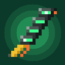

<div align="center">



# サンデヴィスタン

**『サイバーパンク エッジランナーズ』のミリテク「アポジー」サンデヴィスタン — Minecraft 1.20.1 (Fabric) 用**

[](https://www.minecraft.net/)
[](https://fabricmc.net/)
[](https://adoptium.net/)
[](https://discord.gg/ghxC6H2htE)

[🇷🇺 Русский](README.md) · [🇬🇧 English](README.en.md) · [**🇯🇵 日本語**](README.ja.md)

</div>

---

> **「時間は贅沢品だ。サンデヴィスタンがあれば、それを手に入れられる。」**
>
> サイバーウェアを脊髄に装着し、**V** を押すと周囲の時間がゆっくりになり、
> 残像の軌跡を残します。ただし使いすぎると**サイバーサイコシス**を発症します。

---

## ✨ 特徴

| | |
|---|---|
| ⏳ **時間遅延** | 周囲 **64 ブロック**以内の世界が **15%** の速度まで遅くなります。発動時間は最大 **9 秒**、クールダウンは最大 **15 秒**で、消費した残量に応じて変化します。 |
| 👤 **装着者は通常速度** | 装着したプレイヤーは通常の移動速度を保ちます。他のプレイヤーも遅くできます（ゲームルール）。 |
| 🌀 **視覚効果** | ゴーストトレイル、衝撃波リング、パーティクル、`sandy` / `psycho` ポストエフェクト、軽いカメラの揺れ。 |
| 🧠 **サイバーサイコシス** | 使いすぎると画面の歪み、ノイズ、耳鳴り、デバフ、ダメージが発生します。ゲージが溜まり切ると大変なことに。 |
| 🖥️ **HUD** | チャージバー、クールダウン表示、装着状態。 |
| 🔊 **サウンド** | 発動、ループ、警告、フラットラインの専用サウンド。 |
| 🌐 **多言語対応** | ロシア語・英語・日本語。 |
| 🔌 **互換性** | **Capri** とのソフト連携。未導入でも問題なく動作します。 |

## 📦 導入方法

### 必要環境

| コンポーネント | バージョン |
|---|---|
| Minecraft | **1.20.1** |
| Fabric Loader | **0.15.11+** |
| Fabric API | **0.92.2+1.20.1** |
| Java | **17+** |

### 方法 1 — 配布 JAR

1. [Releases](https://github.com/watsbunny/sandevistan/releases) から最新の `sandevistan-*.jar` をダウンロードします。
2. Minecraft プロファイルの `mods` フォルダに入れます。
3. **Fabric Loader** と **Fabric API** が入っていることを確認します。
4. ゲームを起動します。

### 方法 2 — ソースからビルド

```bash
git clone https://github.com/watsbunny/sandevistan.git
cd sandevistan
./gradlew build
```

完成した JAR は `build/libs/sandevistan-1.0.0+1.20.1.jar` に出力されます。

## 🎮 操作

| キー | 動作 |
|---|---|
| アイテムを**右クリック** | サンデヴィスタンを脊髄に装着 |
| **V** | 時間遅延のON / OFF |

キーは **設定 → 操作 → サンデヴィスタン** で変更できます。

## 💬 コマンド

実行にはオペレーター権限レベル（**2**）が必要です。

| コマンド | 説明 |
|---|---|
| `/sandevistan install [プレイヤー]` | サンデヴィスタンを付与・装着 |
| `/sandevistan remove [プレイヤー]` | サンデヴィスタンを除去 |
| `/sandevistan toggle` | 時間遅延の切り替え |
| `/sandevistan psycho <プレイヤー> <0–1000>` | サイバーサイコシス値を設定（デバッグ用） |

## ⚙️ ゲームルール

| ゲームルール | 初期値 | 説明 |
|---|---|---|
| `sandevistanSlowsPlayers` | `true` | 発動中のサンデヴィスタン付近の他プレイヤーも遅くする |
| `sandevistanCyberpsychosis` | `true` | 使いすぎによるサイバーサイコシスの蓄積を有効にする |

例：

```mcfunction
/gamerule sandevistanCyberpsychosis false
```

## 🧩 互換性

- **Fabric API** — 必須です。
- **Capri** — オプション。`Class.forName` で検出し、未導入の場合は連携を無効化します。
- **Satin** — シェーダーライブラリは JAR 内に同梱（JiJ）されているため、別途導入は不要です。

## 🗂️ プロジェクト構成

```
sandevistan/
├─ src/main/java/com/watsbunny/sandy/
│  ├─ Sandevistan.java         エントリポイント、アイテム、ゲームルール
│  ├─ SandyServer.java         サーバー側の時間遅延処理
│  ├─ SlowClock.java           時間速度の計算
│  ├─ SandyCommand.java        /sandevistan コマンド
│  ├─ cyber/                   アイテム、脊髄、サイバーサイコシス
│  └─ client/                  HUD、シェーダー、残像、エフェクト、ミックスイン
├─ src/main/resources/
│  ├─ assets/sandevistan/      テクスチャ、サウンド、シェーダー、言語
│  ├─ data/sandevistan/        レシピ、タグ、ダメージタイプ
│  └─ *.mixins.json            ミックスイン設定
├─ build.gradle
└─ gradle.properties
```

## 🛠️ ビルド

**JDK 21**、ターゲット **Java 17**、**Gradle 8.9** で動作確認済みです。

```bash
./gradlew build       # MOD をビルド
./gradlew runClient   # デバッグ用にクライアントを起動
```

## 💬 コミュニティ

開発者公式 Discord では、質問・不具合報告・最新情報の確認ができます：

<div align="center">

[](https://discord.gg/ghxC6H2htE)

**https://discord.gg/ghxC6H2htE**

</div>

## 📜 ライセンス

**All Rights Reserved.** ソースコードは個人での学習目的にのみ提供されています。
作者の許可なく公開・再配布・改変ビルドの配布を行うことは禁止されています。

---

<div align="center">

Made with ❤️ by **WatsBunny**

[Discord](https://discord.gg/ghxC6H2htE) · [GitHub](https://github.com/watsbunny)

<sub>『サイバーパンク エッジランナーズ』の世界観に基づく非公式ファンプロジェクトです。Minecraft は Mojang Studios の商標です。</sub>

</div>
